# Laboratorio 4: Quadtree para logística de entregas

**Estudiante:** Zareth Mariana Vega Sanchez

**Curso:** Estructuras de Datos y Laboratorio

---

## 1. Problema y objetivo

Un sistema de logística de entregas tiene las coordenadas (x, y) de **10.000 puntos de entrega** de una ciudad (datos estáticos) y debe responder rápido dos preguntas:

1. ¿Qué puntos de entrega están a un **radio de 500 metros** de un punto dado?
2. ¿Cuál es el punto de entrega **más cercano** a una ubicación dada?

El objetivo es **implementar un Quadtree desde cero** (sin librerías de árboles como scipy), generalizado a K dimensiones, y **compararlo con fuerza bruta** para responder: **¿desde qué tamaño de datos el Quadtree empieza a ser más rápido que la fuerza bruta?**

---

## 2. Respuesta corta

| Consulta | Contra fuerza bruta con listas (la línea base del enunciado) | Contra fuerza bruta vectorizada con NumPy (referencia adicional) |
|---|---|---|
| Búsqueda en radio de 500 m | **Desde N = 50** puntos (cruce estimado ≈ 27) | Más rápido en **todos** los tamaños medidos (desde N = 5), aunque por poco entre N = 100 y N = 1.000 (mínimo 1,2x con N = 200) |
| Vecino más cercano | **Desde N = 100** puntos (cruce estimado ≈ 79) | **Desde N = 1.000** (cruce estimado ≈ 657) |

Con los **10.000 puntos del enunciado**, el Quadtree es **32,9x** (radio) y **59,1x** (vecino más cercano) más rápido que la fuerza bruta con listas, y **3,4x** y **6,1x** más rápido que la versión con NumPy. Calcula en promedio 40 distancias en la búsqueda por radio y 9 en el vecino más cercano, frente a las 10.000 de la fuerza bruta.

**Importante:** el punto de cruce no depende solo del Quadtree sino de qué tan buena sea la fuerza bruta con la que se compara. Con listas el cruce está en unas decenas de puntos; con NumPy se corre a cientos de puntos (vecino) o desaparece (radio). Detalles en la sección 8.

---

## 3. Contenido del repositorio

| Archivo o carpeta | Qué contiene |
|---|---|
| `Quadtreetree.py` | El Quadtree de K dimensiones desde cero, la fuerza bruta de referencia, los generadores de datos y la conversión de latitud/longitud a metros. |
| `test.py` | 23 pruebas unitarias, las verificaciones visuales (radio, vecinos, partición) y el análisis de las pruebas. Genera las gráficas de `graficas/` y `graficas/resumen_pruebas.txt`. |
| `analisis.py` | Los experimentos de rendimiento (escalamiento, radio y dimensión), las estadísticas, las gráficas de rendimiento y la discusión (`resultados/discusion.md`). |
| `resultados/` | Salida real de `analisis.py`: `crudo.csv` (cada medición), `resumen.csv` (estadísticas), `pendientes.csv`, `entorno.json` y `discusion.md`. |
| `graficas/` | Las 11 gráficas (4 de verificación y 7 de rendimiento) y `resumen_pruebas.txt`. |
| `README.md` | Este documento. |

---

## 4. Cómo ejecutar

```bash
pip install matplotlib numpy                      # solo para las gráficas y la referencia con NumPy

python test.py                                    # pruebas + verificación visual -> graficas/
python analisis.py --perfil rapido --salida prueba --graficas prueba/graficas      # comprobar (segundos), NO usar para conclusiones
python analisis.py --perfil completo --salida resultados --graficas graficas       # el experimento real
python analisis.py --solo-resumen --salida resultados --graficas graficas          # regenera tablas, gráficas y discusión sin volver a medir
```

El perfil completo tardó **1.031,8 s (unos 17 minutos)** en el equipo de la sección 7. Los datos y las consultas se generan con semillas, por lo que **las métricas de trabajo (distancias, cajas examinadas, puntos devueltos) se reproducen idénticas en cualquier máquina**; los tiempos, no.

---

## 5. Cómo funciona el Quadtree

### 5.1 La idea

Un Quadtree divide el espacio en cuadrantes de forma recursiva: si una caja tiene demasiados puntos, se parte en 4 cajas iguales (por la mitad en cada eje); si tiene pocos, se deja como hoja. Las zonas densas de la ciudad terminan con cajas pequeñas y las zonas casi vacías con cajas grandes. Para una consulta, solo hay que mirar las cajas que tocan la zona de interés y se **descartan** (se "podan") las demás sin revisar sus puntos.

```
Ciudad                          Árbol
+-----------+-----------+              raíz
|    NO     |    NE     |           /   |   |   \
|           |           |         SO   SE  NO  NE      cada caja con más de 8 puntos
+-----------+-----------+                              se divide otra vez en 4
|    SO     |    SE     |
|           |           |
+-----------+-----------+
```

### 5.2 Generalización a K dimensiones

El código no está limitado a 2D: cada nodo se divide por el punto medio de **todos** los ejes a la vez, y el hijo al que pertenece un punto se calcula con una máscara de K bits (el bit d vale 1 si la coordenada d es mayor o igual que el centro). Solo se guardan los hijos que tienen puntos, para que la memoria no crezca como 2^K.

| K (dimensiones) | Nombre habitual | Hijos por nodo (2^K) |
|---|---|---|
| 1 | árbol binario | 2 |
| 2 | quadtree | 4 |
| 3 | octree | 8 |
| 4 | — | 16 |
| K | hyperquadtree | 2^K |

### 5.3 Construcción

- Cada hoja guarda hasta **8 puntos** (cubeta); si se pasa, se divide. Si hay muchos puntos idénticos que no se pueden separar, la **profundidad máxima (20)** corta la división.
- Las hojas guardan índices de puntos, no copias.
- Con los 10.000 puntos de prueba el árbol tiene **9 niveles, 2.722 hojas y 3.652 nodos**.
- Construir cuesta **O(N log N)**: en los datos reales la pendiente log-log entre N = 1.000 y N = 100.000 es 1,10, frente a 1,11 que daría N·log N exacto.

### 5.4 Búsqueda en radio

Se recorre el árbol con una pila (sin recursión). Para cada caja se calcula su distancia mínima al centro de la consulta:

- si es **mayor que el radio**, la caja se descarta entera;
- si la caja queda **totalmente dentro del círculo**, se toman todos sus puntos sin comparar uno por uno;
- si es una **hoja que toca el círculo**, se calcula la distancia a cada uno de sus puntos.

El resultado sale ordenado por distancia. Es lo que muestra `graficas/particion_quadtree.png` (sección 6).

### 5.5 Vecino más cercano (y los k más cercanos)

Se usa una cola de prioridad con las cajas ordenadas por su distancia mínima a la consulta: siempre se explora primero la caja más prometedora, y se detiene cuando la mejor caja pendiente ya no puede mejorar al peor de los k elegidos hasta ese momento.

### 5.6 Que el Quadtree y la fuerza bruta den exactamente lo mismo

Las dos usan la misma función de distancia (`math.dist`), los empates se resuelven por índice y la poda tiene una tolerancia de 1e-12 para que el redondeo nunca descarte un punto justo en el borde. Por eso las pruebas pueden comparar las dos listas con `==`: mismos puntos, mismas distancias, mismo orden.

### 5.7 Unidades: ¿qué significa "500 metros"?

El árbol no sabe de unidades: el radio y las distancias vienen en la misma unidad que las coordenadas. Todo el laboratorio trabaja con **coordenadas en metros** en un plano local, así que `radio=500` son 500 m. Si los datos reales vienen en grados (latitud, longitud), hay que convertirlos antes con `latlon_a_metros`: un grado de longitud no mide lo mismo que uno de latitud, y medir en grados deformaría el "radio de 500 m". La prueba `test_conversion_latlon_a_metros` verifica la conversión contra la fórmula de haversine (error menor al 0,5 % a 1,5 km).

Los datos de este laboratorio son **sintéticos**: una ciudad de 20 km × 20 km con 12 "barrios" (nubes gaussianas, más densos) y un fondo uniforme, para parecerse a una ciudad real.

---

## 6. Verificación de correctitud

**Pruebas unitarias (23, todas pasan).** Comparan el Quadtree con la fuerza bruta en 1, 2, 3, 4 y 5 dimensiones, con radios de 0 a enormes, consultas dentro y fuera de la ciudad, puntos repetidos, puntos justo en el borde del radio (distancia exactamente 500), distintas capacidades de hoja, inserción posterior, validaciones de entrada y la conversión de unidades. Además comprueban que cada punto está en una sola hoja y dentro de su caja.

**Verificación masiva** (`graficas/resumen_pruebas.txt`): 2.000 consultas aleatorias con 10.000 puntos y radio de 500 m, **0 discrepancias** en radio y en vecino más cercano; y la misma comparación en K = 1 a 6 con **0 discrepancias**.

### 6.1 Radio de 500 m: puntos encontrados

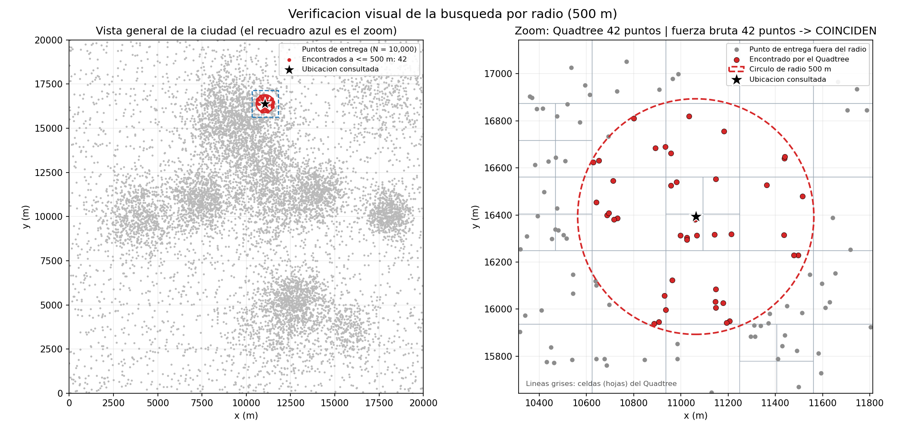

**Cómo leerla.** A la izquierda, la ciudad entera con la ubicación consultada (estrella negra), el círculo de 500 m y los puntos encontrados (rojo); el recuadro azul es la zona ampliada. A la derecha, el zoom: puntos rojos = encontrados por el Quadtree, puntos grises = otros puntos de entrega, líneas grises = celdas del Quadtree. Se ve que todos los puntos dentro del círculo están en rojo y ninguno de afuera lo está. El título del zoom compara el resultado con la fuerza bruta: **42 puntos y 42 puntos, coinciden**. Si hubiera una discrepancia aparecería marcada en magenta.

### 6.2 Vecinos más cercanos

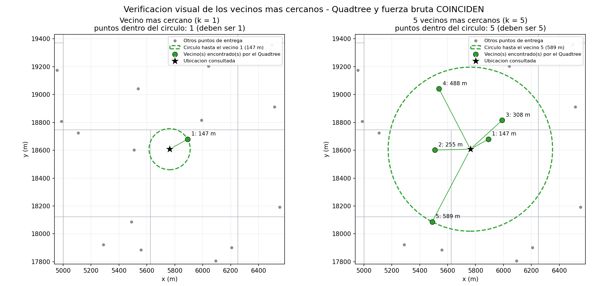

**Cómo leerla.** A la izquierda, el vecino más cercano (k = 1): una línea verde lo une con la ubicación consultada y el círculo verde tiene como radio justo esa distancia (147 m). Si el resultado es correcto, **ningún otro punto puede estar dentro del círculo**: el título lo comprueba ("puntos dentro del círculo: 1, deben ser 1"). A la derecha, los 5 más cercanos numerados con su distancia (147, 255, 308, 488 y 589 m), con el círculo hasta el quinto y la misma comprobación (5 de 5).

### 6.3 Cómo poda el árbol

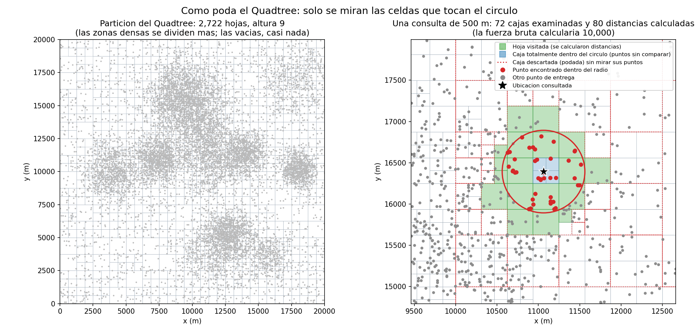

**Cómo leerla.** A la izquierda, la partición completa: las zonas densas tienen celdas pequeñas y las vacías, celdas grandes. A la derecha, una sola consulta de 500 m: en **verde**, las hojas visitadas (se calcularon distancias a sus puntos); en **azul**, una caja totalmente dentro del círculo (sus puntos se toman sin comparar); con **línea roja punteada**, las cajas descartadas sin mirar sus puntos. Esta consulta examinó **72 cajas y calculó 80 distancias, en vez de las 10.000** de la fuerza bruta.

### 6.4 Dos mil consultas

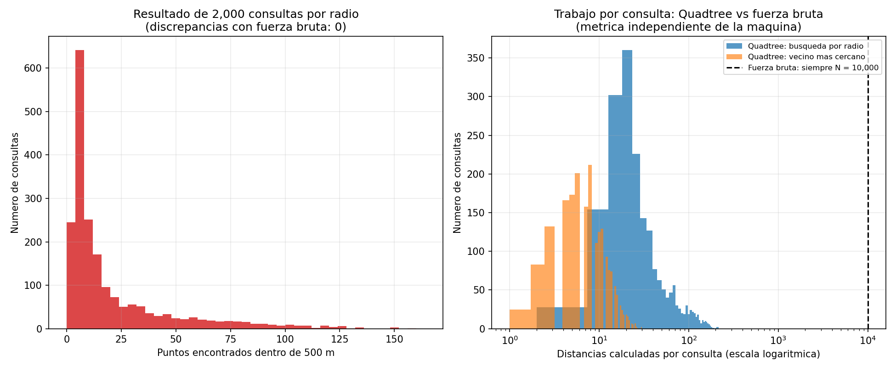

**Cómo leerla.** A la izquierda, cuántos puntos devolvió cada consulta de 500 m (promedio 20,7, mediana 9, máximo 166): la distribución está muy sesgada porque en los barrios densos entran muchos más puntos que en las zonas vacías. A la derecha, las distancias que calculó el Quadtree por consulta (eje logarítmico) frente a la línea vertical de la fuerza bruta (siempre 10.000): el Quadtree calcula en promedio **42 distancias en radio (0,42 % de N; máximo 215, el 2,15 %)** y **9 en vecino más cercano (0,09 %; máximo 30)**. Es una métrica determinista: no depende de la máquina.

---

## 7. Metodología experimental

| Elemento | Detalle |
|---|---|
| Datos | N puntos sintéticos en una ciudad fija de 20 km × 20 km (coordenadas en metros); N = 5, 10, 20, 50, 100, 200, 500, 1.000, 2.000, 5.000, 10.000, 20.000, 50.000, 100.000 |
| Consultas | Q = 5.000 ubicaciones uniformes sobre la ciudad (incluye zonas sin entregas); radio de 500 m |
| Métodos | **Quadtree**; **fuerza bruta con listas** (la línea base del enunciado: mismo código de distancia que el Quadtree); **fuerza bruta con NumPy** (referencia adicional: el mismo recorrido completo vectorizado) |
| Repeticiones | R = 10 por punto, con datos y consultas distintos en cada una (semilla distinta); los tres métodos reciben exactamente los mismos datos y consultas |
| Medición | Tiempo por consulta con `perf_counter`, recolector de basura desactivado, orden de los métodos barajado, calentamiento previo y verificación de correctitud fuera del cronómetro |
| Fuerza bruta con listas | Usa menos consultas por medición cuando N crece, con un presupuesto de 10 millones de distancias: 5.000 consultas con N = 1.000, 1.000 con N = 10.000 y 100 con N = 100.000. Por eso **todo se compara por consulta** |
| Estadística | Media, desviación estándar muestral, intervalo de confianza del 95 % (t de Student) y valores atípicos con la regla de Tukey (no se descartan: se cuentan) |
| Experimentos auxiliares | Radio de 50 m a 10 km con N = 10.000; dimensión K = 2 a 8 con N = 10.000 y datos uniformes (R = 5) |

| Dato                                     | Valor |
|------------------------------------------|---|
| Sistema operativo                        | Windows 11 (`Windows-11-10.0.26300-SP0`), AMD64 |
| CPU                                      | `AMD64 Family 25 Model 68 Stepping 1, AuthenticAMD` |
| Núcleos lógicos                          | 16 |
| RAM total                                | 15,25 GB |
| Python                                   | CPython 3.14.5 (compilación MinGW GCC UCRT, 64 bits) |
| NumPy                                    | 2.4.6 |
| Fecha de la última corrida               | 2026-11-02, 19:59:08 |
| Duración total                           | 1.031,8 s (unos 17 minutos) |
| Ejecutado en Colab                       | No |
| Recolector de basura durante la medición | Desactivado |

**Punto de cruce.** Se define como el primer tamaño N medido en que la media del Quadtree es menor que la de la fuerza bruta **y sigue siéndolo en todos los tamaños mayores**. Para estimar dónde se cruzan las curvas se interpola en escala log-log entre ese tamaño y el anterior; es solo una estimación entre dos tamaños medidos.

---

## 8. Resultados y análisis

### 8.1 Tiempo por consulta según N

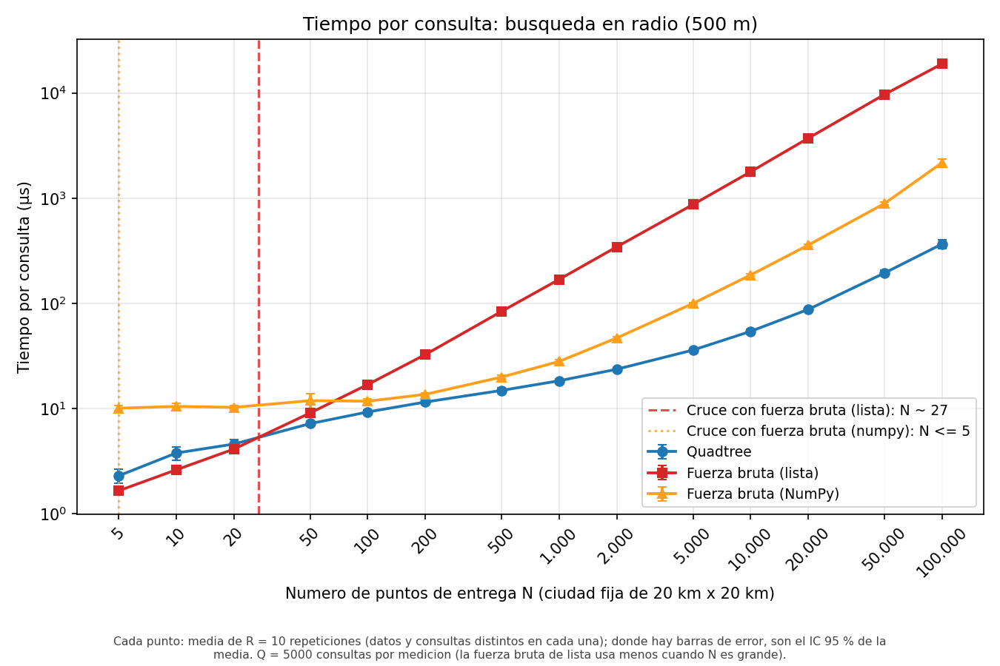

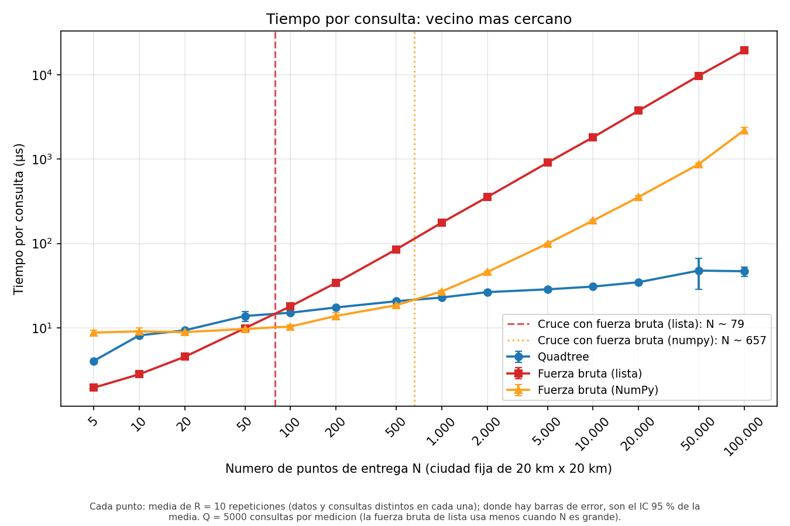

**Qué muestran.** El eje X es el número de puntos de entrega N y el eje Y el tiempo por consulta en microsegundos; ambos en escala logarítmica, de modo que una recta es una potencia `tiempo ≈ c·N^k` y su inclinación es el exponente k. **Azul = Quadtree, rojo = fuerza bruta con listas, naranja = fuerza bruta con NumPy.** Cada punto es la media de 10 repeticiones y las barras son el intervalo de confianza del 95 % (casi no se ven porque son pequeñas). Las **líneas verticales discontinuas** marcan el punto de cruce estimado con cada fuerza bruta (rojo con listas, naranja con NumPy).

**Datos de origen.** `resultados/resumen.csv`, filas con `experimento = escalamiento` y `consulta = radio` o `vecino`; el eje Y es la columna `media_us` y las barras `ic95_us`. Cada `media_us` es el promedio de 10 filas de `crudo.csv` (una por repetición).

**Radio de 500 m**

| N | Quadtree (µs) | Lista (µs) | NumPy (µs) | Lista ÷ Quadtree | NumPy ÷ Quadtree |
|---|---|---|---|---|---|
| 5 | 2,3 | 1,7 | 10,1 | 0,7x | 4,4x |
| 20 | 4,6 | 4,1 | 10,3 | 0,9x | 2,2x |
| 100 | 9,3 | 16,9 | 11,7 | 1,8x | 1,3x |
| 1.000 | 18,4 | 168,8 | 28,0 | 9,2x | 1,5x |
| 10.000 | 54,2 | 1.781,6 | 185,9 | 32,9x | 3,4x |
| 100.000 | 366,6 | 18.926,9 | 2.174,5 | 51,6x | 5,9x |

**Vecino más cercano**

| N | Quadtree (µs) | Lista (µs) | NumPy (µs) | Lista ÷ Quadtree | NumPy ÷ Quadtree |
|---|---|---|---|---|---|
| 5 | 4,0 | 1,9 | 8,8 | 0,5x | 2,2x |
| 20 | 9,3 | 4,5 | 8,9 | 0,5x | 1,0x |
| 100 | 15,1 | 18,0 | 10,3 | 1,2x | 0,7x |
| 1.000 | 22,8 | 176,5 | 27,0 | 7,7x | 1,2x |
| 10.000 | 30,8 | 1.817,4 | 186,8 | 59,1x | 6,1x |
| 100.000 | 46,8 | 19.491,2 | 2.209,5 | 416,6x | 47,2x |

**Lectura.** La fuerza bruta con listas crece como una recta de pendiente casi 1 (si N se multiplica por 10, el tiempo se multiplica por unos 10). El Quadtree crece mucho más despacio. Con N muy pequeño (5 a 20 puntos) **la lista es más rápida**: el árbol es una sola hoja (con menos de 8 puntos ni siquiera se divide) y solo agrega el costo de manejar la estructura. La fuerza bruta con NumPy es casi plana hasta unos 100 puntos (≈ 10 µs): es el costo fijo de llamar a NumPy, que solo se compensa cuando N es grande.

### 8.2 Aceleración: ¿desde qué N gana el Quadtree?

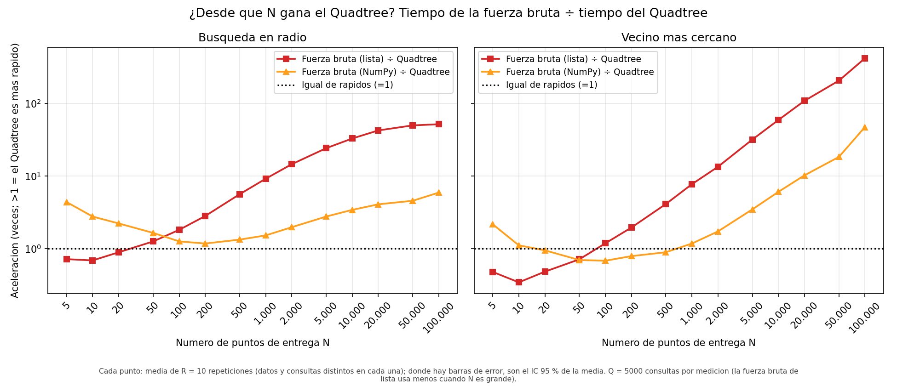

**Qué muestra.** El tiempo de la fuerza bruta dividido por el del Quadtree. **Por encima de la línea punteada (=1) gana el Quadtree**; por debajo, la fuerza bruta. Rojo = contra listas; naranja = contra NumPy; a la izquierda la búsqueda en radio y a la derecha el vecino más cercano.

| N | Radio: Lista ÷ Quadtree | Radio: NumPy ÷ Quadtree | Vecino: Lista ÷ Quadtree | Vecino: NumPy ÷ Quadtree |
|---|---|---|---|---|
| 5 | 0,7x | 4,4x | 0,5x | 2,2x |
| 10 | 0,7x | 2,8x | 0,3x | 1,1x |
| 20 | 0,9x | 2,2x | 0,5x | 1,0x |
| 50 | 1,3x | 1,7x | 0,7x | 0,7x |
| 100 | 1,8x | 1,3x | 1,2x | 0,7x |
| 200 | 2,8x | 1,2x | 2,0x | 0,8x |
| 500 | 5,6x | 1,3x | 4,1x | 0,9x |
| 1.000 | 9,2x | 1,5x | 7,7x | 1,2x |
| 2.000 | 14,6x | 2,0x | 13,4x | 1,7x |
| 5.000 | 24,2x | 2,8x | 31,8x | 3,5x |
| 10.000 | 32,9x | 3,4x | 59,1x | 6,1x |
| 20.000 | 42,4x | 4,1x | 108,4x | 10,2x |
| 50.000 | 49,8x | 4,6x | 205,4x | 18,3x |
| 100.000 | 51,6x | 5,9x | 416,6x | 47,2x |

**Lectura.**

- **Contra listas** el Quadtree gana desde N = 50 (radio) y desde N = 100 (vecino), y la ventaja crece sin parar en el vecino más cercano (hasta 417x con N = 100.000). En el radio se aplana alrededor de 52x por una razón que se explica en 8.3.
- **Contra NumPy** el vecino más cercano solo gana desde N = 1.000: entre N = 20 y N = 500 NumPy es más rápido (entre 0,7x y 1,0x). En la búsqueda por radio el Quadtree está por encima de 1 en todo el rango, pero con una ventaja pequeña entre N = 100 y N = 1.000 (1,2x a 1,5x). El valor de N = 5 es engañoso: allí el "árbol" es una sola hoja y NumPy pierde por su costo fijo.
- Los puntos de cruce están acotados por la malla de tamaños medidos: contra listas, entre N = 20 y 50 (radio) y entre N = 50 y 100 (vecino). Con intervalos de confianza del 95 % sin solaparse, la ventaja es estadísticamente clara desde N = 50 (radio) y N = 100 (vecino) contra listas.

### 8.3 Por qué el Quadtree gana: el trabajo por consulta

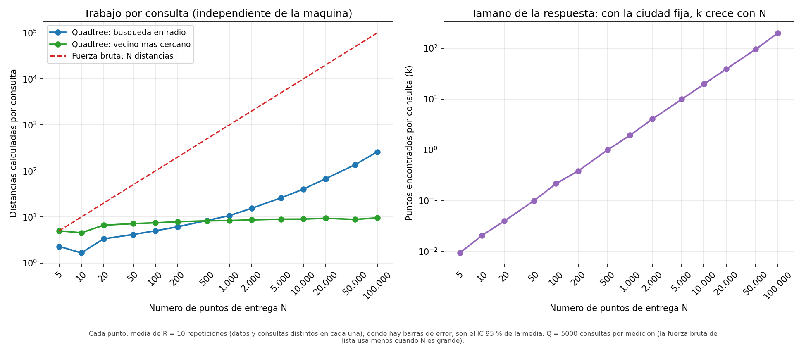

**Qué muestra.** A la izquierda, cuántas distancias entre puntos calcula cada método por consulta: la fuerza bruta siempre calcula N (línea roja discontinua); el Quadtree calcula muy pocas (azul: radio; verde: vecino más cercano). A la derecha, cuántos puntos devuelve en promedio la búsqueda por radio (k). **Estas métricas son deterministas: no dependen de la máquina ni del reloj**, así que separan el efecto del algoritmo del efecto de las constantes de Python.

**Datos de origen.** `resumen.csv`, columnas `distancias_promedio` y `resultados_promedio`.

**Lectura.**

- En el **vecino más cercano** el Quadtree calcula entre 8 y 9 distancias casi sin importar N (a partir de N = 500 la curva verde es plana) y su pendiente de tiempo es 0,16: coherente con O(log N).
- En la **búsqueda por radio** la ciudad es fija, así que al subir N sube la densidad y **el número de puntos que caen dentro de 500 m crece proporcionalmente**: de 0,01 con N = 5 a 200,2 con N = 100.000. El costo del Quadtree es O(log N + k) y k crece con N, por eso su pendiente es 0,52 y no cercana a 0, y por eso la aceleración frente a las listas se aplana (la fuerza bruta es O(N) siempre, pero el Quadtree tampoco puede evitar devolver los k puntos).

### 8.4 Cómo escala cada método (pendientes)

| Consulta | Método | Pendiente (todos los N) | Pendiente (N ≥ 100) | R² (N ≥ 100) |
|---|---|---|---|---|
| radio | Quadtree | 0,46 | 0,52 | 0,949 |
| radio | Fuerza bruta (lista) | 0,97 | 1,02 | 1,000 |
| radio | Fuerza bruta (NumPy) | 0,53 | 0,76 | 0,967 |
| vecino | Quadtree | 0,21 | 0,16 | 0,982 |
| vecino | Fuerza bruta (lista) | 0,96 | 1,02 | 1,000 |
| vecino | Fuerza bruta (NumPy) | 0,55 | 0,78 | 0,969 |

Si el tiempo crece como N^k, la pendiente log-log es k (`resultados/pendientes.csv`). La **fuerza bruta con listas da k ≈ 1**, como predice O(N). El **Quadtree con vecino más cercano da k ≈ 0,16** (cercano a 0, como O(log N)) y con búsqueda por radio 0,52 por el crecimiento de k explicado arriba. NumPy da menos de 1 (≈ 0,8) porque con N pequeño domina su costo fijo; no es una complejidad menor.

### 8.5 Construir el árbol y cuándo se amortiza

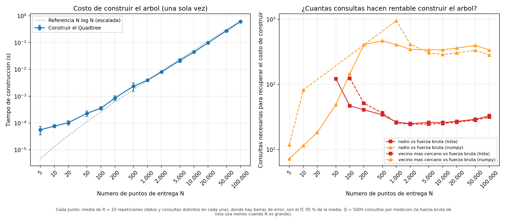

**Qué muestra.** A la izquierda, el tiempo de construir el Quadtree según N (azul) con la referencia N·log N escalada (gris punteada). A la derecha, **cuántas consultas hacen falta para recuperar el costo de construir el árbol**: el tiempo de construcción dividido entre lo que se ahorra por consulta frente a cada fuerza bruta (rojo = listas, naranja = NumPy; continua = radio, discontinua = vecino).

**Lectura.** Con N = 10.000, construir el árbol tarda **44,7 ms** (con N = 100.000, 0,61 s) y sigue la forma N·log N. Como los datos son estáticos, se construye una sola vez: frente a las listas, ese costo se recupera con **26 consultas de radio o 25 de vecino más cercano**; frente a NumPy hacen falta unas **340 y 287**. Si solo se va a hacer una consulta, la fuerza bruta es más barata; el árbol compensa cuando los datos estáticos se consultan muchas veces, que es el caso de un sistema de entregas.

### 8.6 Efecto del radio

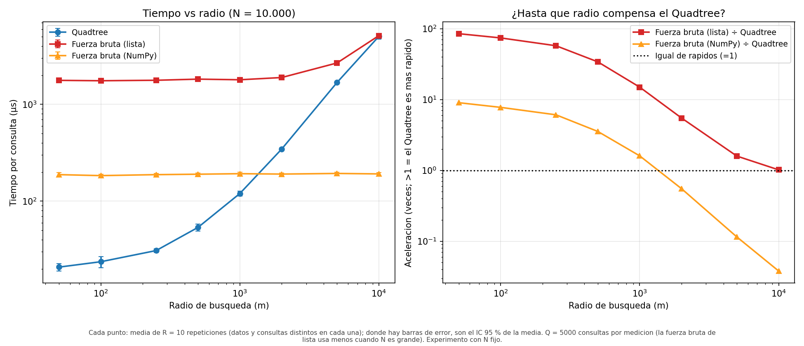

**Qué muestra.** Con N = 10.000 fijo, el tiempo por consulta según el radio de búsqueda (izquierda) y la aceleración respecto a cada fuerza bruta (derecha).

| Radio (m) | Puntos devueltos | Quadtree (µs) | Lista (µs) | NumPy (µs) | Lista ÷ Quadtree | NumPy ÷ Quadtree |
|---|---|---|---|---|---|---|
| 50 | 0,2 | 20,8 | 1.770,2 | 188,0 | 85,0x | 9,0x |
| 100 | 0,8 | 23,7 | 1.754,6 | 183,6 | 74,1x | 7,8x |
| 250 | 4,8 | 30,9 | 1.774,4 | 188,0 | 57,5x | 6,1x |
| 500 | 19,7 | 53,6 | 1.822,8 | 189,9 | 34,0x | 3,5x |
| 1.000 | 78,1 | 120,0 | 1.795,6 | 192,3 | 15,0x | 1,6x |
| 2.000 | 307,1 | 345,5 | 1.894,1 | 190,5 | 5,5x | 0,6x |
| 5.000 | 1.733,5 | 1.683,2 | 2.677,5 | 193,3 | 1,6x | 0,1x |
| 10.000 | 5.376,9 | 5.046,1 | 5.129,5 | 191,3 | 1,0x | 0,0x |

**Lectura.** La fuerza bruta cuesta casi lo mismo para cualquier radio (siempre recorre los N puntos), pero el Quadtree cuesta más cuanto mayor es el radio porque devuelve más puntos y puede podar menos. Contra las listas, la ventaja baja de 85x (radio de 50 m) a 1,0x (10 km, donde la consulta devuelve 5.377 puntos, el 54 % de N: ningún método puede evitar recorrerlos). Contra NumPy el Quadtree pierde la ventaja a partir de un radio de unos **1.359 m** (entre 1.000 m y 2.000 m; la consulta devuelve entonces entre 78 y 307 puntos, el 1 % al 3 % de N). **El radio de 500 m del enunciado queda en la zona favorable** (34x contra listas y 3,5x contra NumPy).

### 8.7 Efecto de la dimensión K

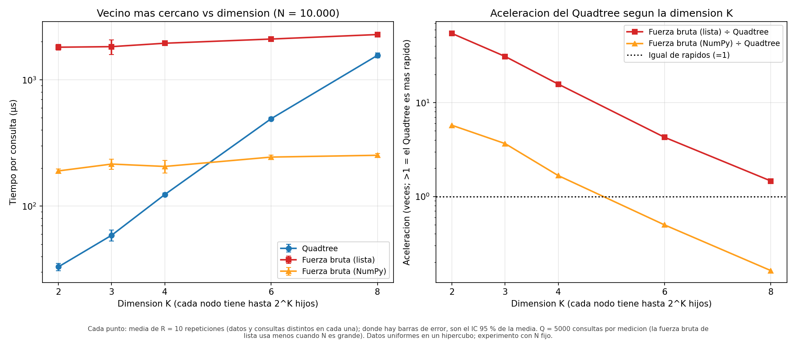

**Qué muestra.** Vecino más cercano con N = 10.000 puntos uniformes en un hipercubo, para K = 2 a 8: el tiempo por consulta (izquierda) y la aceleración respecto a cada fuerza bruta (derecha).

| K | Hijos máx. por nodo | Quadtree (µs) | Lista (µs) | NumPy (µs) | Lista ÷ Quadtree | NumPy ÷ Quadtree | Dist. entre puntos | Cajas examinadas | Dist. a cajas |
|---|---|---|---|---|---|---|---|---|---|
| 2 | 4 | 33,1 | 1.809,3 | 189,9 | 54,7x | 5,7x | 8,2 | 8,8 | 27,5 |
| 3 | 8 | 58,8 | 1.828,0 | 215,2 | 31,1x | 3,7x | 13,7 | 11,2 | 48,8 |
| 4 | 16 | 123,4 | 1.945,2 | 206,0 | 15,8x | 1,7x | 24,8 | 15,5 | 96,5 |
| 6 | 64 | 491,4 | 2.099,6 | 244,4 | 4,3x | 0,5x | 82,5 | 36,4 | 314,5 |
| 8 | 256 | 1.559,0 | 2.279,2 | 252,5 | 1,5x | 0,2x | 81,7 | 95,0 | 923,2 |

Las tres últimas columnas son métricas deterministas por consulta (las dos primeras salen de `resumen.csv`; la tercera, de `graficas/resumen_pruebas.txt`, que genera `test.py`).

**Lectura.** La ventaja del Quadtree se **pierde al crecer K**: contra las listas baja de 55x (K = 2) a 1,5x (K = 8) y contra NumPy el árbol deja de ganar entre K = 4 (1,7x) y K = 6 (0,5x). Es la "maldición de la dimensionalidad".

Hay un detalle que las distancias entre puntos esconden: con K = 6 y K = 8 el árbol calcula **las mismas distancias entre puntos (82 y 82)** y, sin embargo, el tiempo se triplica. El costo está en otra parte: cada caja examinada obliga a calcular la distancia a **todos sus hijos no vacíos** (hasta 2^K), y eso no aparece en esa columna. De K = 2 a K = 8 el tiempo se multiplica por 47, las distancias entre puntos por 10, las cajas examinadas por 11 y las **distancias a cajas por 34** (28 → 923 por consulta), la métrica que mejor acompaña al tiempo. La explicación de fondo habitual (con un número fijo de puntos, casi todas las cajas quedan vacías y la distancia al vecino más cercano se parece cada vez más a la de cualquier otro punto, por lo que la poda descarta menos cajas) es coherente con los datos, pero este experimento no la mide directamente.

---

## 9. Conclusiones

1. **Respuesta a la pregunta del laboratorio.** Contra la fuerza bruta con listas, el Quadtree empieza a ser más rápido **desde unas decenas de puntos**: desde N = 50 en la búsqueda por radio (cruce estimado ≈ 27) y desde N = 100 en el vecino más cercano (≈ 79). Con los 10.000 puntos del enunciado la ventaja es de 33x y 59x.
2. **El cruce depende de la línea base.** Con la fuerza bruta vectorizada (NumPy) el cruce del vecino más cercano se corre a N ≈ 657 y la ventaja con 10.000 puntos baja a 3,4x y 6,1x. Que el Quadtree "gane" depende de con qué se compare.
3. **La complejidad se cumple.** La fuerza bruta escala con pendiente ≈ 1 (O(N)); el Quadtree escala con ≈ 0,16 en el vecino más cercano (O(log N)) y en el radio crece con k, el número de puntos devueltos (O(log N + k)); construir cuesta O(N log N) (pendiente medida 1,10).
4. **La ventaja depende de la consulta.** Es máxima con radios pequeños y se pierde cuando el radio devuelve una fracción grande de los puntos (≈ 3 % de N contra NumPy; 54 % de N contra listas).
5. **La ventaja depende de la dimensión.** El diseño funciona para K dimensiones, pero con K = 6 a 8 deja de compensar frente a NumPy.
6. **Vale la pena por ser datos estáticos:** el costo de construir se recupera con unas 26 consultas frente a listas.

---

## 10. Limitaciones

- **Python es interpretado.** Los tiempos absolutos y, sobre todo, el punto de cruce dependen de las constantes de la implementación; en C++ el cruce sería distinto, con las mismas tendencias.
- **Datos sintéticos.** En una ciudad real, la distribución cambia la altura del árbol y el trabajo por consulta.
- **Consultas uniformes** sobre la ciudad (incluyen zonas sin entregas). Consultas concentradas en barrios densos devolverían más puntos.
- **Resolución del cruce.** Está acotada por la malla de N medida: el cruce con listas está entre N = 20 y 50 (radio) y entre N = 50 y 100 (vecino); la cifra interpolada es solo una estimación.
- **Ruido.** Hay 107 valores atípicos de 1200 (8,9 %). El coeficiente de variación mediano es 4,4 % en radio, 4,6 % en vecino y 12,2 % en construcción. El único punto de consulta con intervalo de confianza mayor al 20 % de su media es el Quadtree con vecino más cercano y N = 50.000 (se ve en la gráfica como una barra de error larga).
- **Mediciones cortas.** 88 de 123 mediciones duran menos de 1 s en total (la más corta, 8 ms); como se promedian miles de consultas y el coeficiente de variación es bajo, el tiempo por consulta es estable, pero las más cortas son más sensibles al sistema operativo.
- **Fuerza bruta con listas con pocas consultas** cuando N es grande (100 con N = 100.000), por lo que esas mediciones tienen más ruido.
- **Una sola máquina y un solo sistema operativo.**
- **Dimensión.** El experimento usa 5 repeticiones y datos uniformes; con datos agrupados el resultado podría cambiar.

---

## 11. Uso de herramientas de IA

Se usó **Claude (Anthropic)** como apoyo en este laboratorio: guía, depuración y revisión del código de `Quadtreetree.py`, `test.py` y `analisis.py`; guía de diseño de la metodología experimental y estadística; análisis de los resultados y redacción de esta documentación. Las tablas de este documento se generaron con un script a partir de `resultados/resumen.csv`, `resultados/pendientes.csv` y `graficas/resumen_pruebas.txt`.

**Qué se verificó.** Las 23 pruebas unitarias pasan; la verificación masiva (2.000 consultas) y la de K = 1 a 6 dan 0 discrepancias con la fuerza bruta; las métricas deterministas (distancias, cajas examinadas, puntos devueltos) se reprodujeron de forma independiente con las mismas semillas y coinciden con las de la corrida; el resumen y las pendientes se regeneraron desde `crudo.csv` y salieron idénticos.